# 💡 Primeiros Passos com ESP32: Instalando a Arduino IDE e Piscando um LED (Blink)

> Guia passo a passo para quem **nunca encostou em uma placa microcontroladora**.
> Ao final, o LED da sua placa estará piscando por conta de um programa que **você mesmo** enviou. 🎉

---

## 📑 Sumário

1. [O que você vai aprender](#-o-que-você-vai-aprender)
2. [Conceitos básicos (leia com calma)](#-conceitos-básicos-leia-com-calma)
3. [O que você precisa](#-o-que-você-precisa)
4. [Passo 1 – Instalar a Arduino IDE](#passo-1--instalar-a-arduino-ide)
5. [Passo 2 – Ensinar a IDE a conhecer o ESP32](#passo-2--ensinar-a-ide-a-conhecer-o-esp32)
6. [Passo 3 – Instalar o driver USB](#passo-3--instalar-o-driver-usb)
7. [Passo 4 – Conectar a placa ao computador](#passo-4--conectar-a-placa-ao-computador)
8. [Passo 5 – Escolher a placa e a porta](#passo-5--escolher-a-placa-e-a-porta)
9. [Passo 6 – Escrever o código Blink](#passo-6--escrever-o-código-blink)
10. [Passo 7 – Enviar o código para a placa (Upload)](#passo-7--enviar-o-código-para-a-placa-upload)
11. [Entendendo o código linha por linha](#-entendendo-o-código-linha-por-linha)
12. [Experimentos para fixar](#-experimentos-para-fixar)
13. [Extra: piscando um LED externo](#-extra-piscando-um-led-externo)
14. [Solução de problemas](#-solução-de-problemas)
15. [Glossário](#-glossário)
16. [Próximos passos](#-próximos-passos)

---

## 🎯 O que você vai aprender

- Instalar a **Arduino IDE** (o programa onde escrevemos o código).
- Configurar a IDE para trabalhar com a placa **ESP32**.
- Conectar a placa ao computador com segurança.
- Enviar seu primeiro programa: o **Blink** (fazer um LED piscar).
- Entender o que cada linha do código faz.

⏱️ **Tempo estimado:** 30 a 45 minutos.

---

## 🧠 Conceitos básicos (leia com calma)

Antes de colocar a mão na massa, vale entender alguns termos. Sem pressa, são poucos!

| Termo | O que é, em palavras simples |
|---|---|
| **Microcontrolador** | Um "mini computador" dentro de um único chip. Ele não tem tela nem teclado: executa **um programa** que você gravou nele e controla coisas (LEDs, motores, sensores). |
| **ESP32** | Um microcontrolador fabricado pela empresa Espressif. É popular porque é barato, rápido e já vem com **Wi-Fi** e **Bluetooth**. |
| **Placa de desenvolvimento (DevKit)** | A plaquinha que você tem em mãos. Ela pega o chip ESP32 e adiciona entrada USB, botões, LED e pinos de fácil acesso. |
| **Arduino IDE** | Programa gratuito para computador onde você **escreve** o código e o **envia** para a placa. (IDE = Ambiente de Desenvolvimento Integrado.) |
| **Sketch** | O nome que a Arduino IDE dá a um programa (arquivo `.ino`). |
| **GPIO** | "Pino de entrada/saída de uso geral". São os pinos da placa que você liga e desliga por código. Cada um tem um número (GPIO 2, GPIO 4...). |
| **LED** | Uma pequena lâmpada que acende quando recebe energia. Tem polaridade (lado positivo e negativo). |
| **Upload / Gravar** | O ato de enviar seu programa do computador para a memória da placa. |
| **Driver** | Um "tradutor" que permite ao computador conversar com a placa pelo cabo USB. |

### 🔁 Como tudo funciona (visão geral)

```
 Você escreve o código      Compilação             Upload via USB          A placa executa
 na Arduino IDE      ───►  (vira linguagem  ───►   (cabo USB)       ───►   o programa e
                            de máquina)                                    o LED pisca! 💡
```

---

## 🧰 O que você precisa

### Hardware

- ✅ 1 placa **ESP32** (DevKit). Qualquer modelo comum serve, por exemplo ESP32 DevKit V1 ou ESP32-WROOM-32.
- ✅ 1 **cabo USB** compatível com a sua placa (geralmente **Micro-USB** ou **USB-C**).

> ⚠️ **Muito importante:** use um cabo que transmita **dados**, e não apenas carga. Alguns cabos baratos (como os de fones e luminárias) só carregam e o computador **nunca vai reconhecer a placa**. Se algo não funcionar, o cabo é o suspeito número 1.

### Software

- ✅ Um computador com **Windows 10/11, macOS ou Linux**.
- ✅ Conexão com a internet (para baixar a IDE e os arquivos da placa).
- ✅ Cerca de **1 GB** de espaço livre em disco.

### Opcional (apenas para o [Extra](#-extra-piscando-um-led-externo))

- 1 LED de 5 mm (qualquer cor)
- 1 resistor de 220 Ω a 330 Ω
- 1 protoboard e 2 fios jumper

---

## Passo 1 – Instalar a Arduino IDE

1. Abra o navegador e acesse a página oficial: **<https://www.arduino.cc/en/software>**

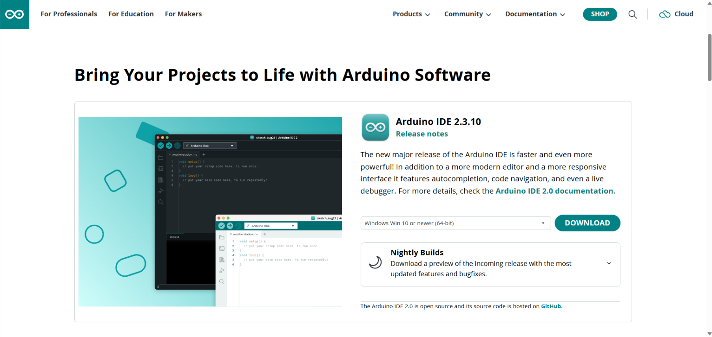

2. Procure a seção **Arduino IDE 2.x** (use sempre a versão 2 ou mais recente).
3. Clique no download correspondente ao seu sistema:
   - **Windows** → *Win 10 and newer, 64 bits* (instalador `.exe`)
   - **macOS** → *Apple Silicon* (chips M1/M2/M3...) ou *Intel* (Macs mais antigos)
   - **Linux** → *AppImage* ou *ZIP file*
4. Na tela seguinte, o site pode pedir uma doação. Você pode clicar em **"JUST DOWNLOAD"** para baixar gratuitamente.

### 🪟 Instalando no Windows

1. Dê dois cliques no arquivo `.exe` baixado.
2. Aceite o contrato de licença (**I Agree**).
3. Mantenha as opções padrão e clique em **Next** → **Install**.
4. Se o Windows perguntar se deseja instalar drivers de dispositivos Arduino, clique em **Instalar**.
5. Ao final, clique em **Finish** para abrir a IDE.

### 🍎 Instalando no macOS

1. Abra o arquivo `.dmg` baixado.
2. Arraste o ícone da **Arduino IDE** para a pasta **Aplicativos**.
3. Abra pelo Launchpad. Se aparecer um aviso de segurança, clique em **Abrir**.

### 🐧 Instalando no Linux

1. Baixe o arquivo **AppImage**.
2. Dê permissão de execução:
   ```bash
   chmod +x arduino-ide_*_Linux_64bit.AppImage
   ```
3. Execute-o:
   ```bash
   ./arduino-ide_*_Linux_64bit.AppImage
   ```
4. Para poder usar a porta USB sem ser administrador, adicione seu usuário ao grupo `dialout` e **reinicie a sessão** (faça logout e login):
   ```bash
   sudo usermod -aG dialout $USER
   ```

✅ **Como saber que deu certo?** A Arduino IDE abre mostrando um código com `void setup()` e `void loop()`.

---
## Passo 1: Preparar a Arduino IDE e Pacote ESP32


Por padrão, a Arduino IDE reconhece apenas placas da família Arduino. Para trabalhar com o ESP32, precisamos adicionar o repositório da Espressif.

### 1.1 Adicionar a URL do Pacote ESP32

1. Abra a **Arduino IDE**.
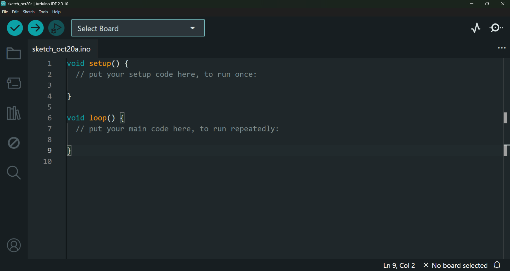
2. Acesse as preferências do sistema:
   - **Windows/Linux:** Menu `File` → `Preferences`
   - **macOS:** Menu `Arduino IDE` → `Settings`
   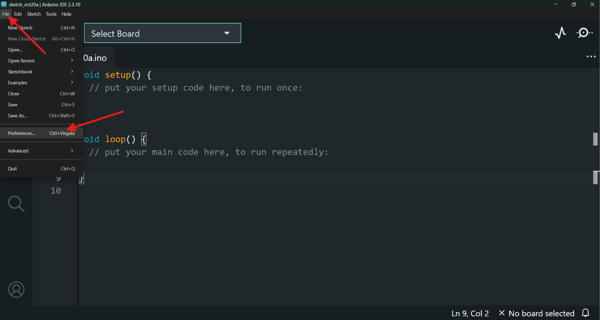
3. Localize o campo **"Additional boards manager URLs"** (*URLs Adicionais para o Gerenciador de Placas*).
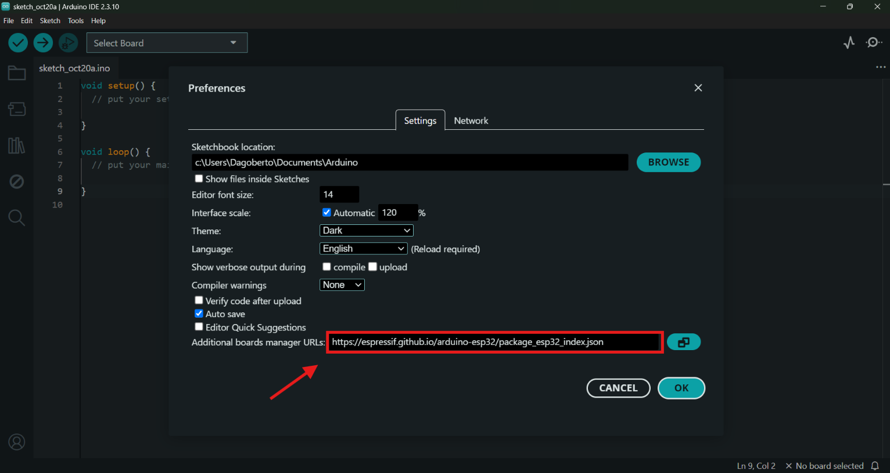
4. Cole a seguinte URL no campo:
   ```text
   https://espressif.github.io/arduino-esp32/package_esp32_index.json
   ```
   *(Nota: Se o campo já contiver outra URL, clique no ícone de janela ao lado e adicione este endereço em uma nova linha).*
5. Clique em **OK** para salvar.


---

### 1.2 Instalar as Placas ESP32

1. No menu lateral esquerdo, clique no ícone do **Boards Manager** (Gerenciador de Placas) ou acesse via menu: `Tools` → `Board` → `Boards Manager...`.
2. Na barra de busca, digite **`esp32`**.
3. Localize a opção **"esp32 by Espressif Systems"** e clique no botão **INSTALL**.
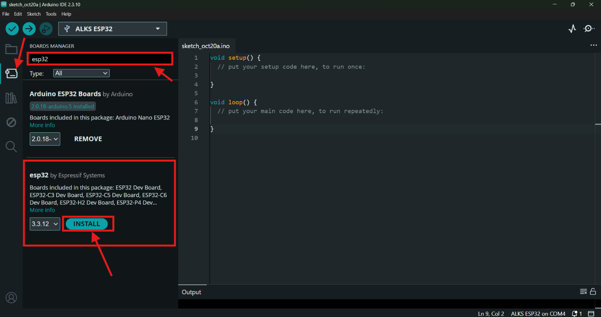
4. Aguarde a conclusão do download e da instalação (pode levar alguns minutos).
5. O status mudará para **"INSTALLED"**.
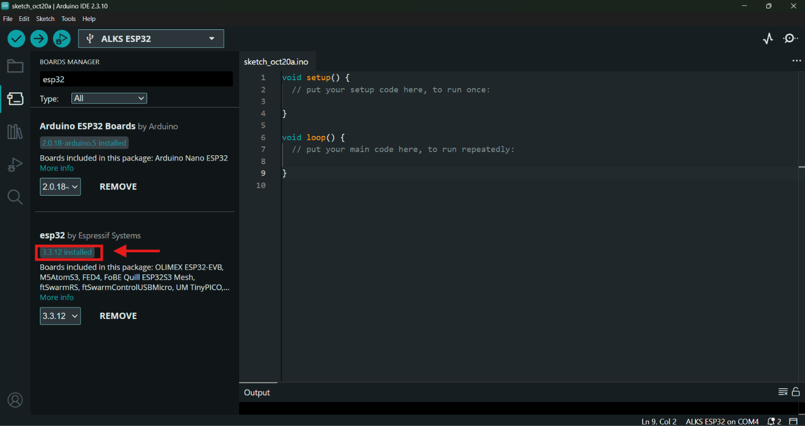


---


## Passo 2: Conectar a Placa com Segurança

1. Segure a placa pelas **bordas laterais** para evitar tocar nos pinos ou no microcontrolador.
2. Conecte o cabo USB primeiro na placa e depois na porta USB do computador.
3. Observe se o **LED de alimentação (Power)** acendeu na placa (geralmente na cor vermelha ou azul).
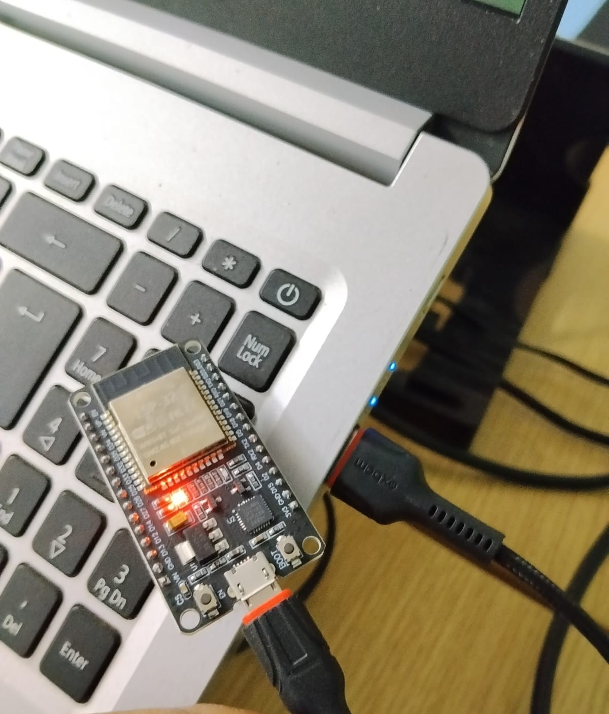


## Passo 4: Selecionar a Placa e a Porta na IDE

Com a placa conectada, precisamos informar à Arduino IDE qual modelo estamos utilizando e em qual porta ela está comunicando.

### 4.1 Selecionar o Modelo da Placa

1. Acesse o menu: `Tools` → `Board` → `esp32`.
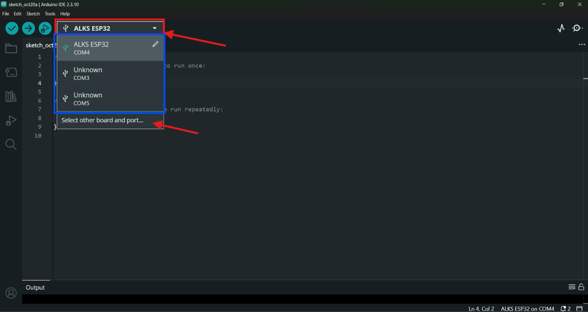
2. Selecione a opção **ESP32 Dev Module**.
   *(Esta opção é compatível com a grande maioria dos modelos DevKit do ESP32).*
   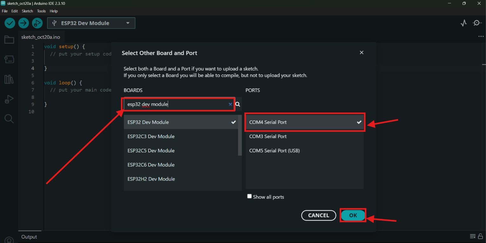
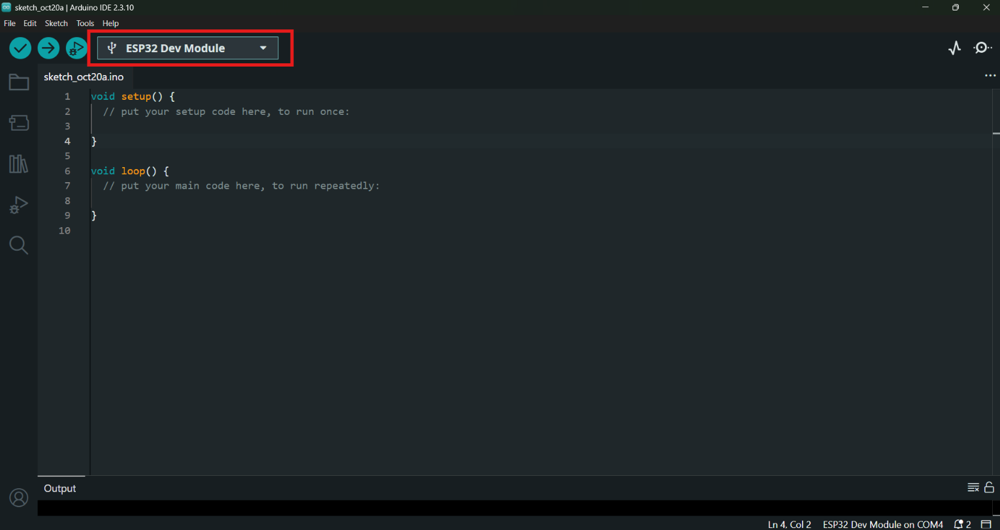

---


Se essa informação aparecer corretamente, seu ambiente está **pronto para gravar códigos no ESP32**!
## Passo 6 – Escrever o código Blink

1. Na Arduino IDE, crie um novo sketch: **File → New Sketch**. (na primeira vez pode pular esse passo)
2. **Apague todo o conteúdo** que aparece na janela.
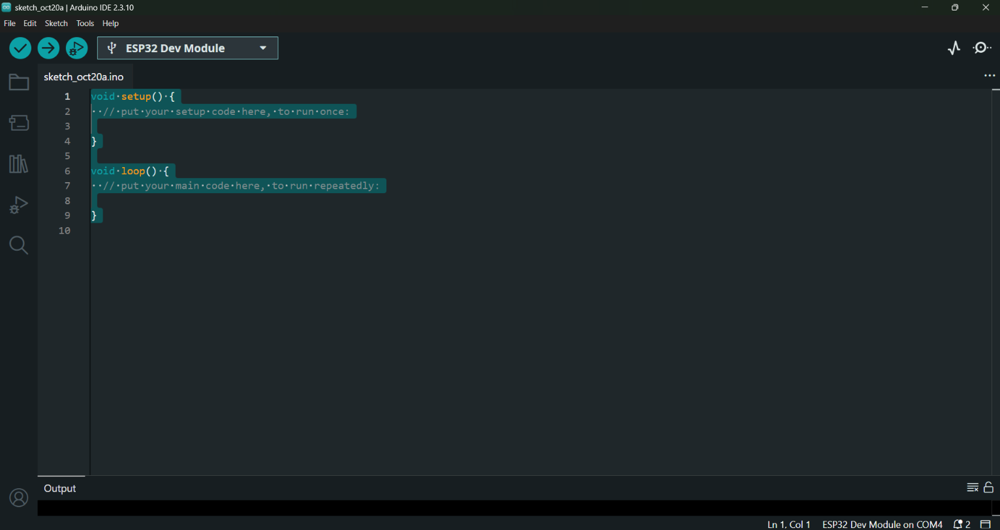
3. Cole o código abaixo:

```cpp
/*
  Blink - Piscar um LED no ESP32
  Este programa liga e desliga o LED da placa a cada 1 segundo.
*/

// Define o número do pino (GPIO) onde o LED está ligado.
// Na maioria das placas ESP32 DevKit, o LED azul da placa está no GPIO 2.
const int PINO_LED = 2;

// A função setup() roda UMA VEZ, quando a placa liga ou reinicia.
void setup() {
  // Configura o pino do LED como SAÍDA (a placa vai "mandar" energia para ele).
  pinMode(PINO_LED, OUTPUT);
}

// A função loop() roda para SEMPRE, repetindo do começo ao fim.
void loop() {
  digitalWrite(PINO_LED, HIGH);  // Liga o LED (envia 3,3 V ao pino)
  delay(1000);                   // Espera 1000 milissegundos (1 segundo)
  digitalWrite(PINO_LED, LOW);   // Desliga o LED (0 V no pino)
  delay(1000);                   // Espera mais 1 segundo
}
```
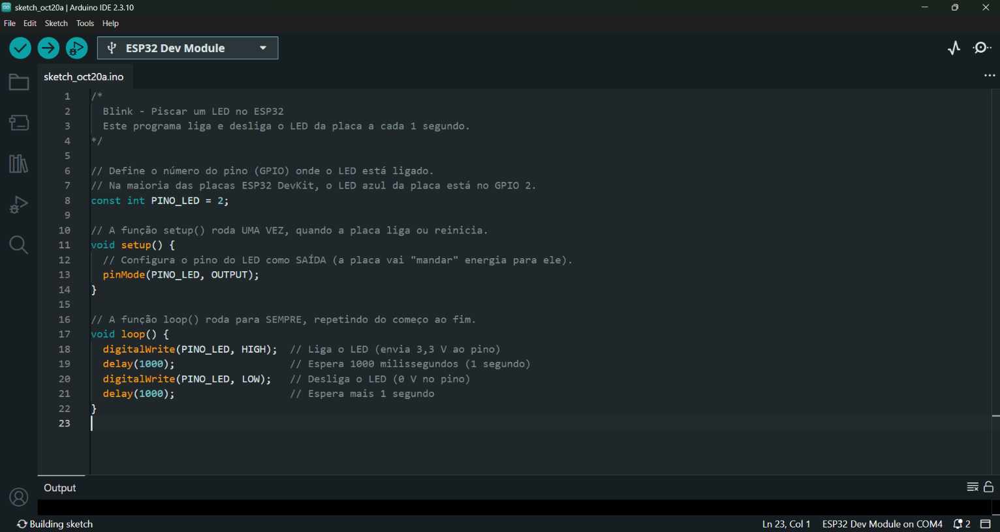
4. Salve o sketch: **File → Save** (atalho `Ctrl+S`). Dê um nome, por exemplo `blink_esp32`, e clique em salvar.
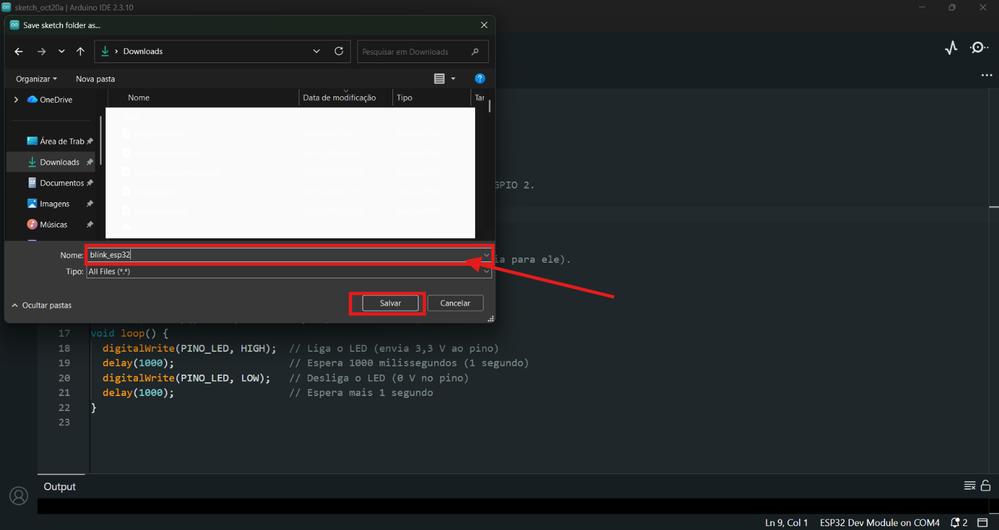

> 📝 **Atenção a detalhes:** a linguagem diferencia maiúsculas de minúsculas (`delay` é diferente de `Delay`), e cada instrução termina com **ponto e vírgula** (`;`).

---

## Passo 7 – Enviar o código para a placa (Upload)

### 7.1 Verificar o código (opcional, mas recomendado)

Clique no botão **✔ (Verify)** no canto superior esquerdo. A IDE confere se há erros de escrita. Na parte inferior deve aparecer algo como **"Done compiling"** (compilação concluída).

### 7.2 Enviar para a placa

1. Clique no botão **→ (Upload)**, ao lado do ✔.
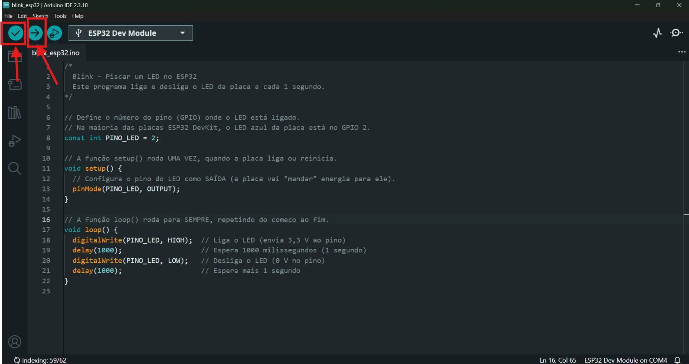
2. Aguarde. Na parte inferior (janela de saída), você verá mensagens de compilação e depois porcentagens de envio:

   ```
   Connecting........_____....
   Writing at 0x00010000... (10 %)
   ...
   Writing at 0x00050000... (100 %)
   Hard resetting via RTS pin...
   ```
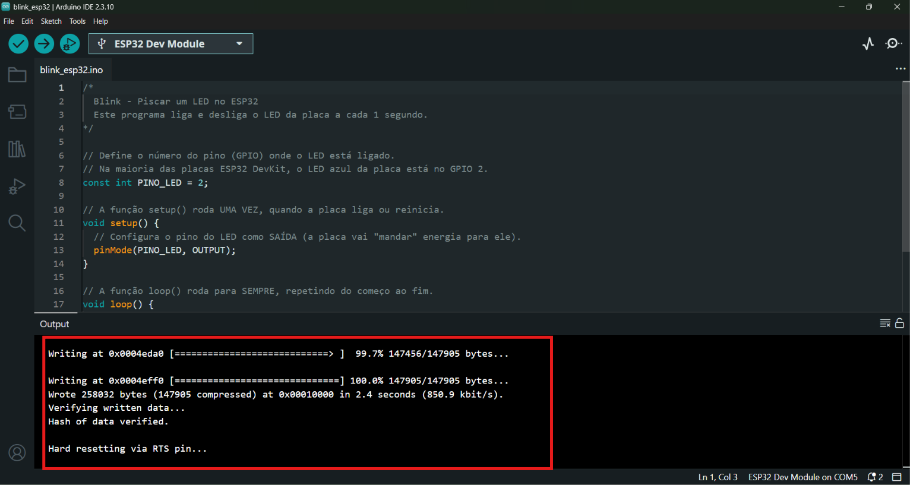
3. Quando terminar, a mensagem **"Done uploading"** aparece.

### RESULTADO

## Projeto em funcionamento

## 🎥 Demonstração do projeto

[▶️ REsultado](resultadoblink.mp4)

### 🔘 O truque do botão BOOT

Em muitas placas ESP32, se a saída ficar travada em **`Connecting........_____....`** e depois mostrar erro, faça isto:

1. Clique em **Upload** novamente.
2. Quando aparecer `Connecting...`, **pressione e segure o botão `BOOT`** da placa (às vezes chamado `IO0`).
3. Quando começarem a aparecer as porcentagens (`Writing at...`), **solte** o botão.

### 🎉 Resultado esperado

O **LED azul** da placa começa a **piscar: 1 segundo aceso, 1 segundo apagado**. Parabéns, você acaba de programar um microcontrolador!

> ℹ️ **Seu LED não pisca, mas o upload deu certo?** Algumas placas têm o LED em outro pino. Veja a seção [Solução de problemas](#-solução-de-problemas).

---

## 🔍 Entendendo o código linha por linha

| Trecho | O que faz |
|---|---|
| `/* ... */` | **Comentário** de várias linhas. É só uma anotação para humanos; a placa ignora. |
| `// ...` | **Comentário** de uma linha. |
| `const int PINO_LED = 2;` | Cria uma "caixinha" com nome `PINO_LED` guardando o número `2`. `const` significa que o valor não muda; `int` significa número inteiro. Assim, se o LED estiver em outro pino, você altera **em um lugar só**. |
| `void setup() { ... }` | Bloco executado **uma única vez** ao ligar a placa. Serve para configurações iniciais. |
| `pinMode(PINO_LED, OUTPUT);` | Diz à placa: "o pino 2 vai **enviar** sinal (OUTPUT = saída)". Sem isso, o pino não controla o LED corretamente. |
| `void loop() { ... }` | Bloco executado **repetidamente, sem parar**. É o "coração" do programa. |
| `digitalWrite(PINO_LED, HIGH);` | Coloca o pino em nível **alto** (3,3 V) → o LED **acende**. |
| `delay(1000);` | **Pausa** o programa por 1000 milissegundos (= 1 segundo). |
| `digitalWrite(PINO_LED, LOW);` | Coloca o pino em nível **baixo** (0 V) → o LED **apaga**. |

### 🧩 Em português claro, o programa diz:

> "Ao ligar: prepare o pino 2 para mandar energia.
> Depois, para sempre: acenda o LED, espere 1 segundo, apague o LED, espere 1 segundo."

---

## 🧪 Experimentos para fixar

Altere o código, clique em **Upload** novamente e observe o que muda:

1. **Piscar mais rápido:** troque os dois `delay(1000)` por `delay(200)`.
2. **Piscar mais devagar:** troque por `delay(3000)`.
3. **Piscada curta (efeito "batimento"):** use `delay(100)` com o LED aceso e `delay(900)` com o LED apagado.
4. **Código Morse "SOS":** pesquise o padrão (3 curtas, 3 longas, 3 curtas) e tente reproduzir. 🚨

> 💡 Mudar o código e testar é a **melhor** forma de aprender. Não tenha medo de errar: você não vai estragar a placa por causa de erros no código.

---

## 🔌 Extra: piscando um LED externo

Quer piscar um LED seu, fora da placa? Veja como.

### Materiais

- 1 LED, 1 resistor de 220 Ω a 330 Ω, protoboard e 2 jumpers.

### Montagem

```
 ESP32 GPIO 4 ──► resistor (220 Ω) ──► perna LONGA do LED (+ ânodo)
                                       perna CURTA do LED (– cátodo) ──► GND da ESP32
```

> ⚠️ **Regras de ouro:**
> - **Sempre** use um resistor em série com o LED. Sem ele, o LED (e até o pino da placa) pode queimar.
> - **Desconecte o cabo USB** antes de montar ou alterar os fios.
> - O LED tem lado certo: a perna **mais longa** é o positivo (+).
> - Confira o diagrama de pinos (*pinout*) da **sua** placa para localizar o GPIO 4 e o GND.

### Código

Basta trocar o número do pino na primeira linha:

```cpp
const int PINO_LED = 4;   // agora usamos o GPIO 4
```

O restante do código permanece igual. Envie novamente e o LED externo vai piscar.

---

## 🛠️ Solução de problemas

| Problema | Provável causa | O que fazer |
|---|---|---|
| **Nenhuma porta aparece** em *Tools → Port* | Cabo só de carga, driver ausente ou porta USB com defeito | Troque o cabo por outro **com dados**; teste outra porta USB; instale o driver ([Passo 3](#passo-3--instalar-o-driver-usb)). |
| `Failed to connect to ESP32: Timed out waiting for packet header` | A placa não entrou no modo de gravação | Use o [truque do botão BOOT](#-o-truque-do-botão-boot). |
| `Could not open COMx, the port doesn't exist` | Porta errada ou placa desconectada | Reconecte a placa e selecione a porta de novo. |
| `Access denied` / `Permission denied` na porta | Outro programa usando a porta ou falta de permissão (Linux) | Feche o Monitor Serial e outros programas; no Linux, rode `sudo usermod -aG dialout $USER` e reinicie a sessão. |
| `'xxxx' was not declared in this scope` | Erro de digitação no código (maiúsculas/minúsculas) | Compare seu código com o do guia, letra por letra. |
| `expected ';' before ...` | Faltou ponto e vírgula na linha anterior | Confira se toda instrução termina com `;`. |
| Upload funcionou, mas **o LED não pisca** | Sua placa tem o LED em outro pino ou não tem LED embutido | Teste `const int PINO_LED = LED_BUILTIN;`. Se não funcionar, use o [LED externo](#-extra-piscando-um-led-externo). |
| Instalação do pacote **esp32 trava ou dá erro** | Conexão instável ou download interrompido | Verifique a internet, feche e reabra a IDE e tente instalar novamente. |
| Placa **esquenta muito** ao conectar | Possível curto-circuito | **Desconecte imediatamente**, revise a montagem e não toque nos fios com a placa ligada. |

---

## 📖 Glossário

- **Compilar:** traduzir o código que você escreve para a linguagem que o chip entende.
- **Cátodo / Ânodo:** os dois lados do LED (negativo / positivo).
- **GND:** "terra", o polo negativo (0 V) do circuito.
- **HIGH / LOW:** nível alto (ligado, 3,3 V) / nível baixo (desligado, 0 V).
- **Milissegundo (ms):** milésimo de segundo. 1000 ms = 1 s.
- **Monitor Serial:** janela da IDE que mostra mensagens enviadas pela placa.
- **Pinout:** diagrama que mostra a função de cada pino da placa.
- **Resistor:** componente que limita a corrente elétrica para proteger outros componentes.
- **Sketch:** programa escrito na Arduino IDE.

---

## 🚀 Próximos passos

Agora que você dominou o básico, continue evoluindo:

1. **Ler um botão** (`digitalRead`) e acender o LED ao apertá-lo.
2. **Usar o Monitor Serial** (`Serial.begin(115200)` e `Serial.println("Olá!")`) para "conversar" com a placa.
3. **Ler um sensor** (temperatura, distância, luminosidade).
4. **Conectar ao Wi-Fi** e controlar o LED pelo celular.
5. **Controlar motores** para o protótipo de robótica. 🤖

---

## 📚 Referências

- Arduino IDE: <https://www.arduino.cc/en/software>
- Documentação oficial do ESP32 para Arduino: <https://docs.espressif.com/projects/arduino-esp32/>
- Referência da linguagem Arduino: <https://www.arduino.cc/reference/pt/>

---

<p align="center">Feito com ☕ e curiosidade. Se este guia te ajudou, deixe uma ⭐ no repositório!</p>