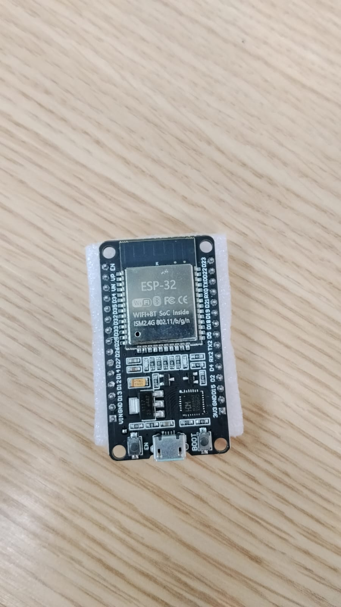
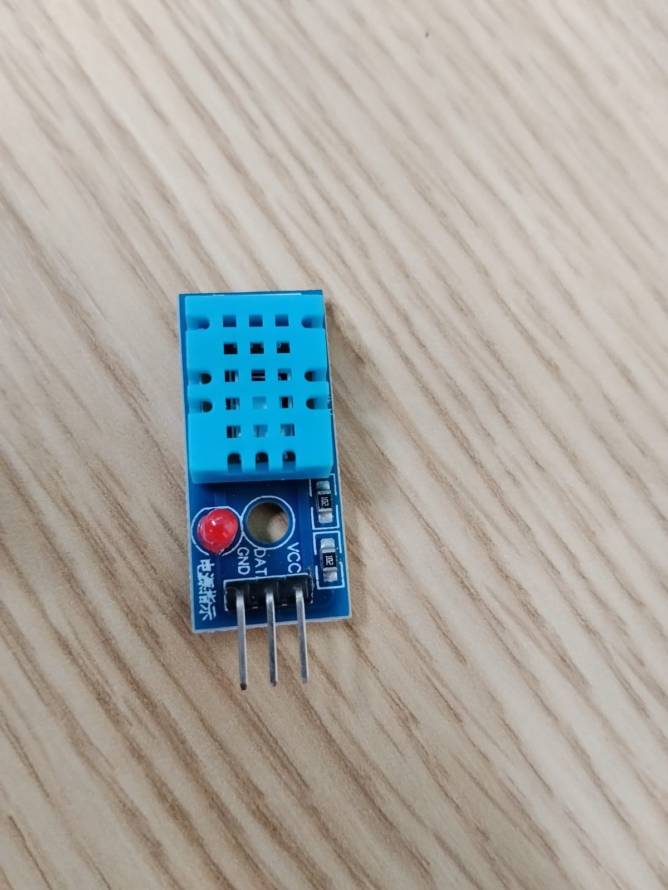
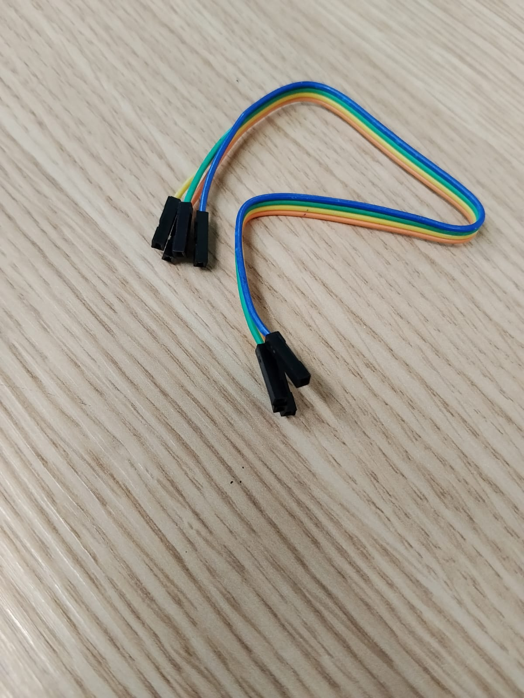
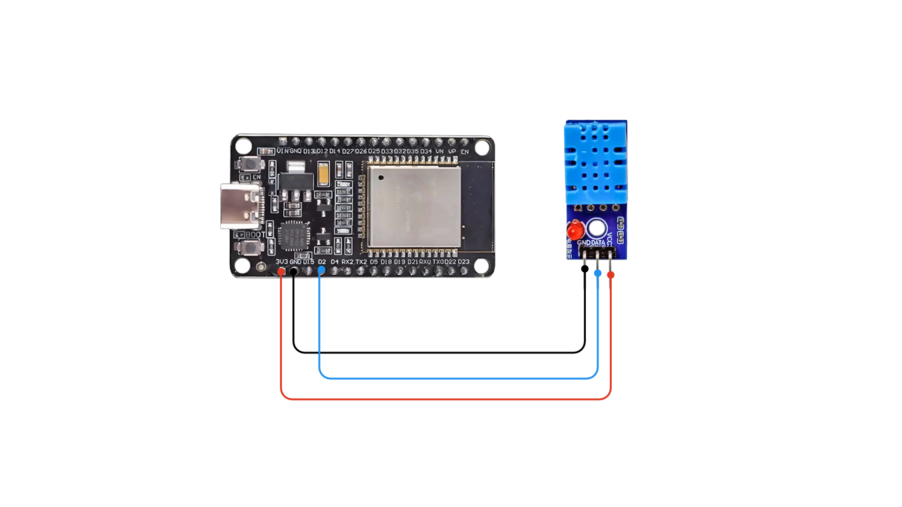
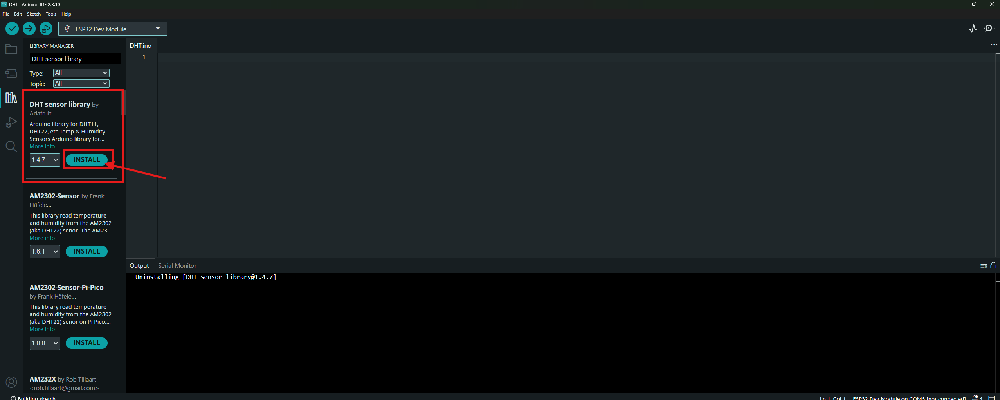
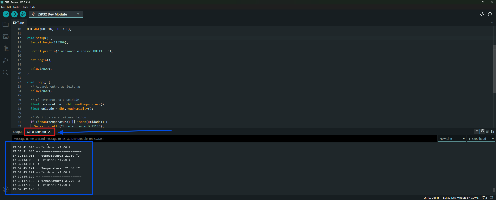

# 🌡️ Sensor DHT11 com ESP32 — Passo a passo

Neste tutorial você vai montar o circuito, configurar a Arduino IDE, carregar o programa no ESP32 e ver a **temperatura (°C)** e a **umidade do ar (%)** no Monitor Serial.

O DHT11 é um sensor digital: ele mede temperatura e umidade e envia os valores ao ESP32 por um **único pino de dados**.

---

## 📑 Sumário

1. [Materiais necessários](#1-materiais-necessários)
2. [Ligações elétricas](#2-ligações-elétricas)
3. [Instalação das bibliotecas](#3-instalação-das-bibliotecas)
4. [Código completo](#4-código-completo)
5. [Configuração da placa e upload](#5-configuração-da-placa-e-upload)
6. [Resultado no Monitor Serial](#6-resultado-no-monitor-serial)
7. [Solução de problemas](#7-solução-de-problemas)
8. [Erro "Wrong boot mode detected (0xb)"](#8-erro-wrong-boot-mode-detected-0xb)
9. [Checklist da prática](#9-checklist-da-prática)

---

## 1. Materiais necessários

| Item | Função |
|------|--------|
| ESP32 Dev Module (DevKit) | Placa que executará o programa |
| Sensor DHT11 | Realiza as medições de temperatura e umidade |
| 3 jumpers fêmea - Fême | Fazem as ligações entre os componentes |
| Cabo USB de dados | Alimenta o ESP32 e envia o código pelo computador |






> ⚠️ Use um cabo USB **de dados**. Cabos só de carga não permitem gravar o programa.

---

## 2. Ligações elétricas

> ⚠️ **Antes de conectar ou remover fios, desconecte o USB do ESP32.**

Usaremos o **GPIO 4** como pino de dados. Você pode usar outro GPIO adequado, desde que altere o código depois.

```text
 DHT11            ESP32
 ─────            ─────
 VCC  ──────────► 3V3
 DATA ──────────► GPIO 4
 GND  ──────────► GND
```

| Pino do DHT11 | Conectar ao ESP32 | Função |
|---------------|-------------------|--------|
| VCC (+) | 3V3 | Alimentação |
| DATA (OUT / S) | D2 | Dados |
| GND (−) | GND | Terra (referência elétrica) |



### Atenções importantes

- **Confira a identificação real dos pinos** no seu sensor, pois a ordem pode variar conforme o fabricante.
- Se o seu DHT11 for o **sensor avulso de quatro pinos** (e não um módulo de três pinos), a ordem dos terminais pode ser diferente e pode ser necessário um **resistor de pull-up** (normalmente 10 kΩ) entre DATA e 3,3 V.
- **Nunca ligue a saída de dados a 5 V.** Os GPIOs do ESP32 trabalham com lógica de **3,3 V**.

---

## 3. Instalação das bibliotecas

1. Abra a **Arduino IDE**.
2. Clique no ícone **Library Manager** (ícone de livros, na barra lateral).
3. Pesquise por `DHT sensor library` e instale a biblioteca cujo autor é **Adafruit**.
4. Pesquise por `Adafruit Unified Sensor` e instale-a, caso ainda não esteja instalada (é uma dependência da biblioteca DHT).



---

## 4. Código completo

Crie um **novo sketch** e cole o código abaixo. Ele faz uma leitura a cada dois segundos e informa se houver erro de leitura.

```cpp
#include <DHT.h>

// Pino de dados do sensor
#define DHTPIN 2

// Tipo de sensor
#define DHTTYPE DHT11

// Cria o objeto do sensor
DHT dht(DHTPIN, DHTTYPE);

void setup() {
  Serial.begin(115200);

  Serial.println("Iniciando o sensor DHT11...");

  dht.begin();

  delay(2000);
}

void loop() {
  // Aguarda entre as leituras
  delay(2000);

  // Lê temperatura e umidade
  float temperatura = dht.readTemperature();
  float umidade = dht.readHumidity();

  // Verifica se a leitura falhou
  if (isnan(temperatura) || isnan(umidade)) {
    Serial.println("Erro ao ler o DHT11!");
    Serial.println("Verifique os fios e o pino DATA.");
    return;
  }

  // Exibe os resultados
  Serial.print("Temperatura: ");
  Serial.print(temperatura);
  Serial.println(" °C");

  Serial.print("Umidade: ");
  Serial.print(umidade);
  Serial.println(" %");

  Serial.println("----------------------");
}
```

### Entenda as partes principais

| Trecho | O que faz |
|--------|-----------|
| `#include <DHT.h>` | Disponibiliza as funções da biblioteca |
| `#define DHTPIN 4` | Informa que o DATA está conectado ao GPIO 4 |
| `#define DHTTYPE DHT11` | Identifica o modelo do sensor |
| `dht.begin()` | Inicializa o sensor |
| `dht.readTemperature()` | Obtém a temperatura em graus Celsius |
| `dht.readHumidity()` | Obtém a umidade relativa do ar |
| `isnan(...)` | Verifica se a leitura retornou um valor inválido |

---

## 5. Configuração da placa e upload

Na Arduino IDE, selecione:

- **Placa:** `ESP32 Dev Module`
- **Porta:** a porta do seu ESP32 (por exemplo, `COM5` no Windows)

Depois, siga a sequência:

1. Conecte o ESP32 ao computador por USB.
2. Clique em **Verificar** (✓) para compilar o código.
3. Clique em **Carregar** (→) para enviar o programa.
4. Se aparecer `Connecting...` e o upload travar e der erro, **desconecte todos os jumper do DHT11 e carregue o código no ESP32 novamente** até a gravação começar e então solte (veja a [seção 8](#8-erro-wrong-boot-mode-detected-0xb)).
5. Ao terminar, abra o **Monitor Serial** e selecione **115200 baud**.

Saída esperada quando a gravação deu certo

```ino
Changed data sectors found, fast reflashing...
Reflashing 1 changed sector at 0x00010000...
Flash will be erased from 0x00010000 to 0x00010fff...
Compressed 4096 bytes to 1809...

Writing at 0x00010000 [                              ]   0.0% 0/1809 bytes... 

Writing at 0x00011000 [==============================] 100.0% 1809/1809 bytes... 
Wrote 4096 bytes (1809 compressed) at 0x00010000 in 0.0 seconds (1200.5 kbit/s).
Reflashing 1 changed sector at 0x00052000...
Flash will be erased from 0x00052000 to 0x00052fff...
Compressed 4096 bytes to 2636...

Writing at 0x00052000 [                              ]   0.0% 0/2636 bytes... 

Writing at 0x00053000 [==============================] 100.0% 2636/2636 bytes... 
Wrote 4096 bytes (2636 compressed) at 0x00052000 in 0.1 seconds (513.2 kbit/s).
Verifying written data...
Hash of data verified.
```

### após dar certo faça as conexões dos jumper novamente no DHT11
---

### abra o monitor serial para ver as informações de temperatura e humidade



## 6. Resultado no Monitor Serial

Se a ligação estiver correta, você verá algo semelhante a:

```text
Iniciando o sensor DHT11...
Temperatura: 27.00 °C
Umidade: 62.00 %
----------------------
Temperatura: 27.00 °C
Umidade: 63.00 %
----------------------
```

> Esses números são apenas exemplos; os valores reais dependem do ambiente.

---

## 7. Solução de problemas

| O que acontece | O que verificar |
|----------------|-----------------|
| `Wrong boot mode detected (0xb)` | Veja a [seção 8](#8-erro-wrong-boot-mode-detected-0xb) |
| `Erro ao ler o DHT11!` | VCC, GND, DATA, GPIO configurado e resistor de pull-up (se necessário) |
| `DHT.h: No such file or directory` | Instale a biblioteca **DHT sensor library** da Adafruit |
| Caracteres estranhos no Monitor Serial | Selecione **115200 baud** |
| Temperatura ou umidade demora a mudar | Aguarde; o DHT11 tem resolução e velocidade limitadas |

---

## 8. Erro "Wrong boot mode detected (0xb)"

Mensagem típica:

```text
A fatal error occurred: Failed to connect to ESP32: Wrong boot mode detected (0xb)!
The chip needs to be in download mode.
```

Isso significa que o código **compilou normalmente**, mas o ESP32 não entrou no modo de gravação. O problema **não** está na biblioteca nem no código.

### 8.1 Force o modo de gravação

Com o ESP32 conectado ao USB:

1. Na Arduino IDE, clique em **Carregar** (→).
2. Quando aparecer `Connecting...`, **pressione e segure BOOT**.
3. Sem soltar BOOT, **pressione e solte EN (ou RST)**, se a placa tiver esse botão.
4. Continue segurando BOOT por mais **2 a 3 segundos**.
5. Solte BOOT e aguarde.

Se funcionar, o console mostrará mensagens como `Writing at...`.

### 8.2 Teste sem nenhum fio

Algum fio ligado aos GPIOs pode estar interferindo na inicialização.

1. Desconecte o USB.
2. Retire **todos os fios** entre o ESP32 e a protoboard, inclusive os do DHT11.
3. Reconecte o USB diretamente ao computador.
4. Tente carregar novamente usando o botão BOOT.

Se funcionar sem os fios, alguma ligação estava atrapalhando. Depois do upload, reconecte o DHT11 com o USB desligado.

### 8.3 Outras verificações

- **Porta:** confirme que a porta selecionada (ex.: `COM5`) é realmente a do ESP32.
- **Cabo USB:** experimente outro cabo que transmita dados.
- **Monitor Serial:** feche-o antes de tentar carregar.
- **Velocidade de gravação:** em **Ferramentas**, se disponível, reduza **Upload Speed** para `115200`.

📖 Mais detalhes: [guia de solução de problemas do esptool (Espressif)](https://docs.espressif.com/projects/esptool/en/latest/troubleshooting.html)

---

## 9. Checklist da prática

- [ ] Conectei VCC ao 3V3 e GND ao GND
- [ ] Conectei DATA ao GPIO 4
- [ ] Instalei a biblioteca DHT da Adafruit
- [ ] Compilei o código sem erros
- [ ] Consegui carregar o código no ESP32
- [ ] Visualizei temperatura e umidade no Monitor Serial

---

## 📚 Referências

- [Biblioteca DHT sensor library (Adafruit)](https://github.com/adafruit/DHT-sensor-library)
- [Solução de problemas do esptool (Espressif)](https://docs.espressif.com/projects/esptool/en/latest/troubleshooting.html)